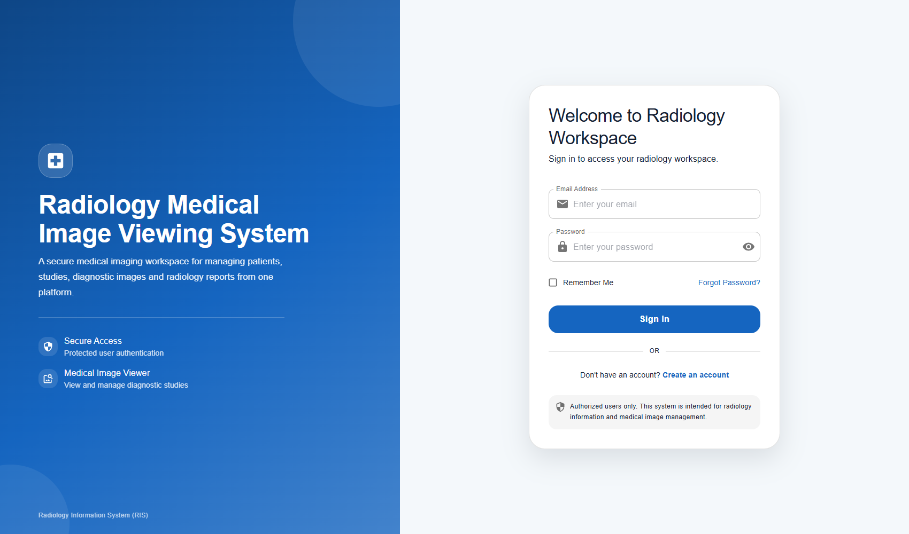
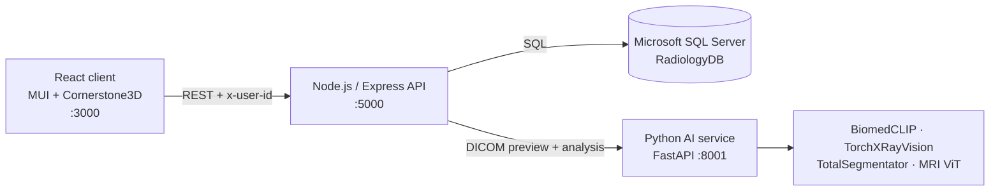

# Radiology Medical Image Viewing System

A web-based Radiology Information System (RIS) for managing patients, studies and reports, with an **OHIF-style DICOM viewer** built on Cornerstone3D and an **AI Copilot** that analyses CT, MRI, X-ray, ultrasound and PET studies.


> ⚠️ **Research / educational project.** AI output is produced by research models, is **not clinically validated**, and must not be used for diagnosis. Every result is labelled for radiologist review.

---

## Features

### Medical image viewer (Cornerstone3D, OHIF-style)
- Renders **original DICOM pixel data** — real window/level in Hounsfield units
- CT window presets: **Soft tissue, Lung, Bone, Brain, Liver, Mediastinum**
- OHIF-style overlays: patient/study info, series description, slice number, thickness and location, W/L and zoom
- **Orientation markers** (A/P/R/L/H/F) that follow rotation and flip
- Mouse-wheel slice scrolling and a slice scrollbar
- Tools: Window/Level, Pan, Zoom, **Length, Angle, Ellipse ROI, Rectangle ROI, Probe** (measurements in mm on DICOM)
- Invert, rotate, flip, reset, fullscreen; JPG/PNG uploads open in the same viewport

### AI Copilot
| Study | Models |
|---|---|
| **CT (DICOM)** | Hounsfield-unit tissue quantification (soft tissue, fat, bone, metal); [TotalSegmentator](https://github.com/wasserth/TotalSegmentator) anatomical segmentation for series with 40+ slices |
| **All modalities** | [BiomedCLIP](https://huggingface.co/microsoft/BiomedCLIP-PubMedBERT_256-vit_base_patch16_224) zero-shot findings chosen by body region, plus a check that images match the study's modality |
| **Chest X-ray** | [TorchXRayVision](https://github.com/mlmed/torchxrayvision) — 18 chest pathology scores |
| **Brain MRI** | ViT brain-tumour classifier (research model) |

Results appear as findings, quantitative measurements and an editable **AI report draft**.


### Radiology workflow
- Login and registration with bcrypt-hashed passwords, per-user data separation
- Dashboard with patient, study, image and report counts
- Patients, studies and series management; DICOM / JPG / PNG upload
- Radiology reports: create, edit and view

| Dashboard | Study list |
|---|---|
|  |  |



---

## Architecture



| Layer | Tech |
|---|---|
| Frontend | React 19, Material UI, Cornerstone3D (`@cornerstonejs/core`, `tools`, `dicom-image-loader`), CRACO |
| Backend | Node.js, Express 5, `mssql`, `multer`, `bcryptjs` |
| AI service | Python, FastAPI, PyTorch, pydicom, open_clip, torchxrayvision, TotalSegmentator |
| Database | Microsoft SQL Server |

---

## Getting started

### Prerequisites
- Node.js 18+ and npm
- Python 3.10+
- Microsoft SQL Server with a database named `RadiologyDB` (tables are created on first start)

### 1. Backend
```bash
cd server
cp .env.example .env      # then fill in your SQL Server credentials
npm install
node server.js            # http://localhost:5000
```

### 2. AI service
```bash
python -m venv .venv
.venv\Scripts\activate          # Windows  (macOS/Linux: source .venv/bin/activate)
pip install -r client/ai-service/requirements.txt
cd client/ai-service
python -m uvicorn app:app --host 127.0.0.1 --port 8001
```
Model weights (~1 GB: BiomedCLIP, TorchXRayVision, TotalSegmentator) download automatically on first use.

### 3. Frontend
```bash
cd client
npm install
npm start                 # http://localhost:3000
```

### Environment variables (`server/.env`)
| Variable | Example | Purpose |
|---|---|---|
| `DB_USER` / `DB_PASSWORD` | — | SQL Server login |
| `DB_SERVER` | `localhost` | SQL Server host |
| `DB_NAME` | `RadiologyDB` | Database name |
| `PORT` | `5000` | API port |
| `AI_SERVICE_URL` | `http://127.0.0.1:8001` | Python AI service |

---

## Project structure

```
├── client/                  React app
│   ├── src/
│   │   ├── pages/           Dashboard, Studies, Patients, ImageViewer, Reports, Settings
│   │   └── components/      DicomViewport (Cornerstone3D), AIAnalysisPanel, Layout
│   ├── ai-service/          FastAPI AI service
│   │   ├── router.py        /api/ai/analyze, /api/ai/render-dicom
│   │   ├── ct_model.py      HU quantification + TotalSegmentator
│   │   ├── vision_models.py BiomedCLIP + TorchXRayVision
│   │   └── mri_model.py     MRI brain-tumour classifier
│   └── craco.config.js      Webpack overrides for Cornerstone codecs
├── server/                  Express API (server.js) + .env.example
└── docs/screenshots/
```

---

## Notes
- For full viewer functionality (HU windowing, mm measurements, orientation) upload **original `.dcm` files**. JPG/PNG exports display but carry no CT values or pixel spacing.
- AI runs on CPU; a study typically takes 5–30 seconds.
- Screenshots use demo / anonymised patient names.

## Author
**Manikanta Reddy** — Radiology Medical Image Viewing System, version 1.0
