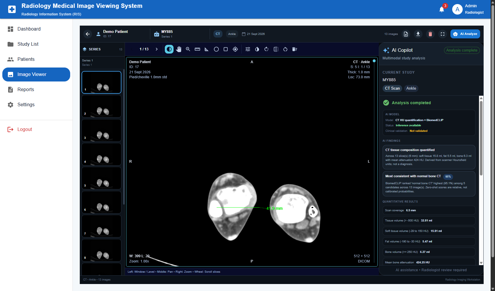
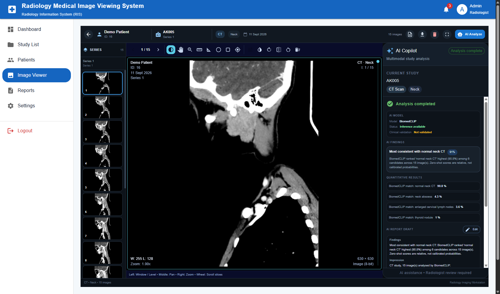
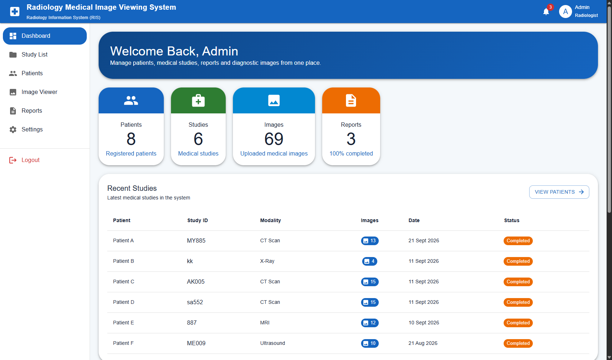
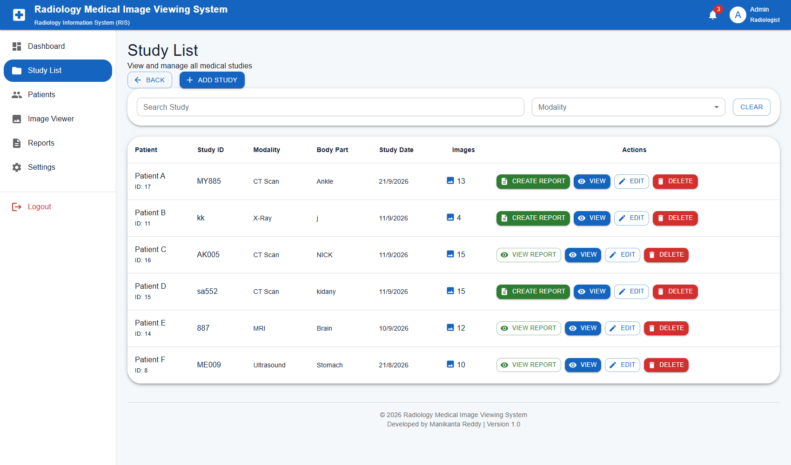
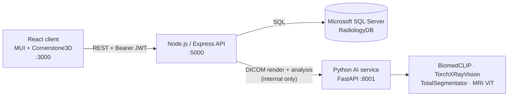

# Radiology Medical Image Viewing System

[](https://github.com/manikantar585-lgtm/Radiology-Medical-Image-Viewing-System/actions/workflows/ci.yml)

A web-based Radiology Information System (RIS) for managing patients, studies and reports. It includes an **OHIF-style DICOM viewer** built on Cornerstone3D and an **AI Copilot** that analyses CT, MRI, X-ray, ultrasound and PET studies.



> ⚠️ **Research / educational project.** AI output comes from research models, is **not clinically validated**, and must not be used for diagnosis. Every result is labelled for radiologist review.

---

## Features

### Medical image viewer (Cornerstone3D, OHIF-style)
- Renders **original DICOM pixel data** with real window/level in Hounsfield units
- CT window presets: **Soft tissue, Lung, Bone, Brain, Liver, Mediastinum**
- OHIF-style overlays: patient and study info, series description, slice number, thickness and location, W/L and zoom
- **Orientation markers** (A/P/R/L/H/F) that follow rotation and flip
- Mouse-wheel slice scrolling and a slice scrollbar
- Tools: Window/Level, Pan, Zoom, **Length, Angle, Ellipse ROI, Rectangle ROI, Probe** (measurements in mm on DICOM)
- Invert, rotate, flip, reset, fullscreen; JPG/PNG uploads open in the same viewport

### AI Copilot
| Study | Models |
|---|---|
| **CT (DICOM)** | Hounsfield-unit tissue quantification (soft tissue, fat, bone, metal); [TotalSegmentator](https://github.com/wasserth/TotalSegmentator) anatomical segmentation for series with 40+ slices |
| **All modalities** | [BiomedCLIP](https://huggingface.co/microsoft/BiomedCLIP-PubMedBERT_256-vit_base_patch16_224) zero-shot findings chosen by body region, plus a check that images match the study's modality |
| **Chest X-ray** | [TorchXRayVision](https://github.com/mlmed/torchxrayvision): 18 chest pathology scores |
| **Brain MRI** | ViT brain-tumour classifier (research model) |

Results appear as findings, quantitative measurements and an editable **AI report draft**.



### Radiology workflow
- Registration and login with bcrypt-hashed passwords and JWT sessions
- Every record is scoped to its owner; users cannot see each other's data
- Dashboard with patient, study, image and report counts
- Patients, studies and series management; DICOM / JPG / PNG upload (up to 500 images per series)
- Radiology reports: create, edit, view and print

| Dashboard | Study list |
|---|---|
|  |  |

---

## Architecture



| Layer | Tech |
|---|---|
| Frontend | React 19, Material UI, Cornerstone3D (`core`, `tools`, `dicom-image-loader`), CRACO |
| API | Node.js 20, Express 5, `mssql`, `zod`, `jsonwebtoken`, `helmet`, `multer` |
| AI service | Python 3.13, FastAPI, PyTorch, pydicom, open_clip, torchxrayvision, TotalSegmentator |
| Database | Microsoft SQL Server |
| Tooling | Jest + Supertest, React Testing Library, pytest, ESLint, Prettier, Ruff, GitHub Actions, Docker Compose |

### API design

The API (`server/src`) is layered so each concern lives in one place:

```
routes/       HTTP layer: zod validation, status codes, response shape
services/     Data access: parameterised SQL, transactions, ownership checks
middleware/   requireAuth (JWT), validate, upload (multer), errorHandler
db/           Connection pool, query helpers, idempotent schema migrations
config/       Environment parsing in one module
```

- **Authentication.** `POST /api/login` returns a signed JWT. Every data route derives the user from the token, never from the request body, query or headers.
- **Authorisation.** Every query filters by the token's user id, so requesting another user's record returns 404.
- **Validation.** Request bodies, params and query strings are parsed with zod schemas before they reach a handler.
- **Errors.** Services throw typed `HttpError`s and one error middleware formats every failure as `{ success: false, message }`.
- **Migrations.** The schema is created and upgraded idempotently on startup, so older databases are migrated in place.

---

## Getting started

### Option A: Docker (whole stack)

```bash
cp .env.example .env        # set SA_PASSWORD and JWT_SECRET
docker compose up --build
```

Open <http://localhost:3000>. SQL Server, the API, the AI service and the web client start together, and the database is created automatically.

### Option B: Run each service locally

**Prerequisites:** Node.js 20+, Python 3.13, and Microsoft SQL Server with a `RadiologyDB` database. Tables are created on first start. Set `DB_CREATE_IF_MISSING=true` to have the API create the database too.

**1. API**
```bash
cd server
cp .env.example .env        # fill in SQL Server credentials and JWT_SECRET
npm install
npm run dev                 # http://localhost:5000
```

**2. AI service**
```bash
python -m venv .venv
.venv\Scripts\activate      # macOS/Linux: source .venv/bin/activate
pip install -r ai-service/requirements-dev.txt
cd ai-service
uvicorn app:app --host 127.0.0.1 --port 8001
```
Model weights (about 1 GB: BiomedCLIP, TorchXRayVision, TotalSegmentator) download automatically on first use.

**3. Web client**
```bash
cd client
npm install
npm start                   # http://localhost:3000
```
Set `REACT_APP_API_URL` if the API is not at `http://localhost:5000`.

### API configuration (`server/.env`)

| Variable | Default | Purpose |
|---|---|---|
| `DB_USER` / `DB_PASSWORD` | — | SQL Server login |
| `DB_SERVER` / `DB_NAME` | `localhost` / `RadiologyDB` | SQL Server host and database |
| `DB_CREATE_IF_MISSING` | `false` | Create the database on startup |
| `JWT_SECRET` | random in development | Token signing key, **required in production** |
| `JWT_EXPIRES_IN` | `8h` | Session length |
| `CORS_ORIGINS` | `http://localhost:3000` | Comma-separated allowed browser origins |
| `AI_SERVICE_URL` | `http://127.0.0.1:8001` | Python AI service |
| `PORT` | `5000` | API port |

---

## Testing and quality checks

| Component | Command (run from the folder) |
|---|---|
| API | `npm test` · `npm run lint` · `npm run format:check` |
| Web client | `npm test` · `npm run lint` · `npm run build` |
| AI service | `pytest` · `ruff check .` |

GitHub Actions runs all of these on every push and pull request ([`.github/workflows/ci.yml`](.github/workflows/ci.yml)).

---

## Project structure

```
├── client/                    React web client
│   ├── src/
│   │   ├── api/http.js        API URL, session storage, auth headers
│   │   ├── pages/             Dashboard, Studies, Patients, ImageViewer, Reports, Settings
│   │   └── components/        DicomViewport (Cornerstone3D), AIAnalysisPanel, Layout
│   ├── craco.config.js        Webpack overrides for Cornerstone codecs
│   └── Dockerfile, nginx.conf
├── server/                    Express API
│   ├── src/                   app, config, db, middleware, routes, services
│   └── tests/                 Jest + Supertest
├── ai-service/                FastAPI AI service
│   ├── router.py              /api/ai/analyze, /api/ai/render-dicom
│   ├── ct_model.py            HU quantification + TotalSegmentator
│   ├── vision_models.py       BiomedCLIP + TorchXRayVision
│   ├── mri_model.py           MRI brain-tumour classifier
│   └── tests/                 pytest
├── docker-compose.yml
└── docs/screenshots/
```

---

## Notes
- For full viewer functionality (HU windowing, mm measurements, orientation), upload **original `.dcm` files**. JPG/PNG exports display but carry no CT values or pixel spacing.
- AI runs on CPU; a study typically takes 5–30 seconds.
- Screenshots use demo or anonymised patient names.

## Author
**Manikanta Reddy**
